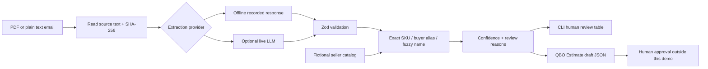

# po-extraction-demo

**Purchase orders in. Reviewable catalog matches and QuickBooks Online Estimate JSON out.**

A small TypeScript / Node.js example for B2B sellers: buyers send PDF purchase orders or informal emails, use their own part numbers, misspell product names, and omit specifications. This demo extracts structured lines, resolves seller catalog items, and produces an Estimate draft plus a human review table.

**This is a simplified demo of a production system.** All sample organizations, products, identifiers, prices, and transactions are invented. There are no customer records, personal names, contact addresses, email addresses, or credentials in the sample data. QuickBooks Online and Anthropic are the requested integration technologies, not sample businesses.

## Run

Requires **Node.js 20.19+** (PDF.js runtime requirement) and npm. Run from this repository root:

```sh
npm i && npm run demo
npm test
npm run typecheck
```

Package installation needs registry access. After installation, the default demo and all tests work offline, without an API key. PDFs are included; generation is optional:

```sh
npm run samples:generate
npm run demo -- --sample email
```

Project commands keep their writes here: npm cache goes to `.cache/npm`, temporary tool files to `.tmp/`, and demo output to `output/`. No QBO request, OAuth login, or remote repository publishing is performed.

## Flow



`ExtractionProvider` returns untrusted `unknown`; `extractOrder` applies the same Zod schema to every provider. Matching and QBO serialization have no LLM dependency. The configured buyer-to-customer mapping is checked against extraction before assigning `CustomerRef`.

## Three fictional purchase orders

| Sample | Layout | Expected behavior |
| --- | --- | --- |
| `samples/table-po.pdf` | One-page table, 3 lines | Exact SKU matches; USD 158.00 draft |
| `samples/email-po.eml` | Free-form plain-text email, 3 lines | 2 buyer-specific aliases + a misspelled product name; USD 89.10 draft |
| `samples/multipage-po.pdf` | Two pages, 4 lines | Preserves page 2 lines, excludes repeated headers and carry-forwards; unspecified washer finish needs review |

The multi-page draft tentatively selects zinc washers and totals USD 97.00. Its source has only USD 73.00 of priced lines. The additional USD 24.00 is a catalog-priced **proposal requiring review**, not an extracted order total.

`scripts/generate-samples.ts` is the PDF source, using `pdf-lib`. Regeneration is deterministic, with fixed metadata. It also refreshes fixture/source hashes; review fixture content and tests manually when changing source content. The email intentionally uses organization-only headers without any address or person. This is a limited plain-text `.eml` example, not a general MIME parser.

## Offline and live extraction

Offline is always the default, even if `ANTHROPIC_API_KEY` exists. The provider reads hand-authored, recorded LLM-shaped responses in `fixtures/`, verifies the source checksum, then validates their contents with Zod. This makes the demonstration deterministic; it does not measure model accuracy.

Live extraction is explicit and sends extracted document text to the Anthropic API. Set `ANTHROPIC_API_KEY` in your shell using your own secret management, then run:

```sh
npm run demo -- --mode live
# Optional model override; choose a structured-output model available to your account:
ANTHROPIC_MODEL=claude-sonnet-5-5 npm run demo -- --mode live --sample table
```

The optional model defaults to `claude-sonnet-5-5`. `.env.example` documents configuration; `.env` files are ignored and are not automatically loaded. The SDK converts the Zod schema to the API's structured-output JSON format; local Zod validation enforces the original constraints and rejects incomplete or invalid responses. Live mode never overwrites fixtures. Tests mock the live API; no credentials or paid calls are needed.

## Matching and review

1. Exact SKU (case insensitive): score `1.00`.
2. Customer part-number alias, scoped to the buyer: score `0.97`.
3. Fuzzy name: `0.35 × token Dice + 0.65 × normalized edit similarity`. Below `0.45`, no candidate is proposed.

Reported confidence is the lower of match score and extraction confidence. Scores below `0.86`, fuzzy alternatives within `0.12`, conflicting/unknown identifiers, numeric specification differences, unit mismatches, or price differences trigger **`needs review`**. Scores are heuristics, not calibrated probabilities. No pack/box quantity conversion occurs. Catalog price is always used in the draft; a differing PO price is shown in review data.

The CLI table shows source description, quantity, unit, proposed SKU, catalog price, method, confidence, status, and reasons. Every document still requires human approval. `candidate` means a proposed line match; it never means approved.

## Output contract

Each run writes two files per sample:

- `output/<sample>.estimate.json`: QBO Estimate create-body shape, using synthetic `CustomerRef.value` and `ItemRef.value` IDs. Includes every proposed line, including those marked for review in the sidecar.
- `output/<sample>.review.json`: source hash/page count, extracted order, matches, confidence, reasons, and `approved: false`.

Example line from the table PO:

```json
{
  "DetailType": "SalesItemLineDetail",
  "Description": "Hex bolt M8 zinc plated [BLT-M8-Z]",
  "Amount": 90,
  "SalesItemLineDetail": {
    "ItemRef": { "value": "101", "name": "Hex bolt M8 zinc plated" },
    "Qty": 200,
    "UnitPrice": 0.45
  }
}
```

`ItemRef.value` is a QBO item ID, not a SKU. The catalog contains both fields deliberately. If any line has no plausible catalog candidate, the entire Estimate is `null` and review data retains every line: no invented IDs or silently dropped items. JSON drafts must be consumed together with their review sidecars. The demo never submits or approves an Estimate. Replace synthetic IDs with realm-specific IDs only in a separate, authenticated integration after review.

Amounts use catalog cents × quantity, rounded once per line to two decimals. Taxes, shipping, discounts, inventory availability, multi-currency rules, and realm-specific accounting configuration are outside this example.

## Tests and limitations

Vitest covers expected quantities, units, matches, methods, review states, QBO IDs/prices/totals for all three real source files, plus source integrity, schema failures, unknown items, size/unit/price conflicts, alias scoping, customer association, and the mocked live adapter. Tests verify deterministic replay and downstream behavior; a separate labeled evaluation set is needed to assess live extraction accuracy.

Text-based PDFs only; scanned pages need OCR. PDF reading order can differ from visual layout. The reader rejects blank-text pages and documents over 20 pages; it is not a hardened parser for hostile uploads. Email support is plain text only, with no attachments, HTML, encoded headers, or MIME multipart decoding. Extraction is not independently reconciled with source totals. Fuzzy matching cannot reliably resolve material, finish, pack size, or near-identical variants. A production system needs stronger specification checks, calibrated confidence, review tooling, idempotency, audit logs, and QBO authentication/error handling.

## Layout

```text
catalog.json               Fictional seller products, aliases, and QBO IDs
samples/                   Three source POs and trusted sample/customer manifest
fixtures/                  Recorded extraction responses with source hashes
scripts/generate-samples.ts Reproducible PDF source
src/                       Reader, providers, schemas, matcher, QBO builder, CLI
tests/                     Offline pipeline and mocked live-adapter tests
output/                    Generated drafts and review sidecars (gitignored)
```

Integration references: [QBO Estimate API](https://developer.intuit.com/app/developer/qbo/docs/api/accounting/all-entities/Estimate), [Anthropic structured outputs](https://platform.claude.com/docs/en/build-with-claude/structured-outputs), [model availability](https://platform.claude.com/docs/en/models/overview), and [PDF.js](https://mozilla.github.io/pdf.js/). These are technical documentation links; the fictional documents contain no domains or contact information.

## License

[MIT](LICENSE).
